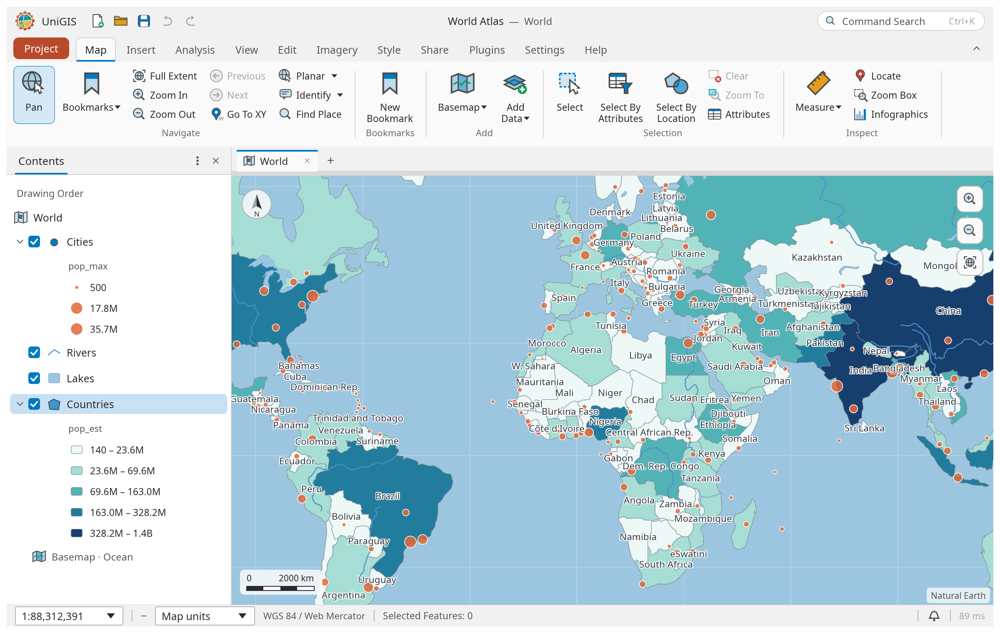
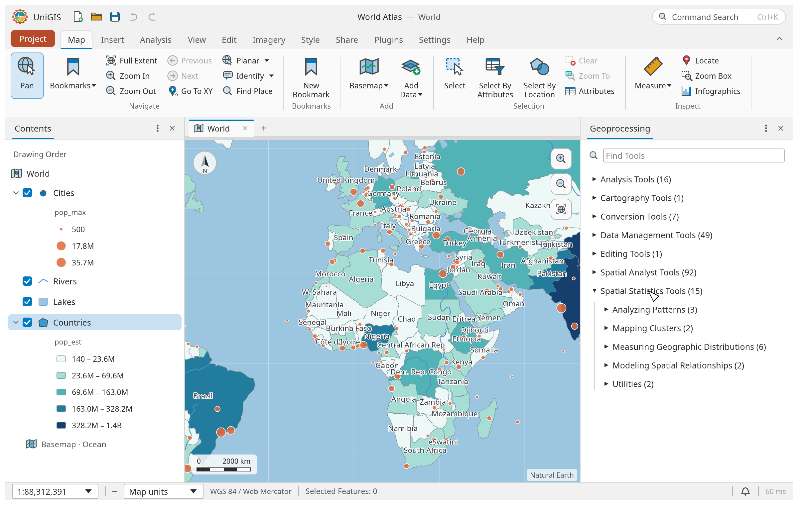
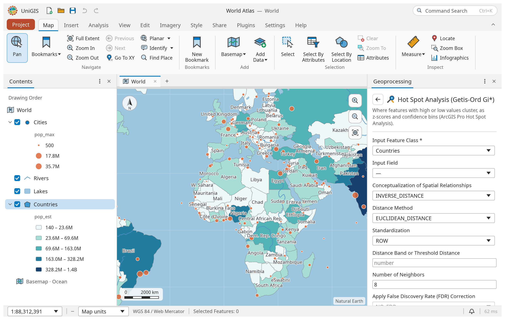
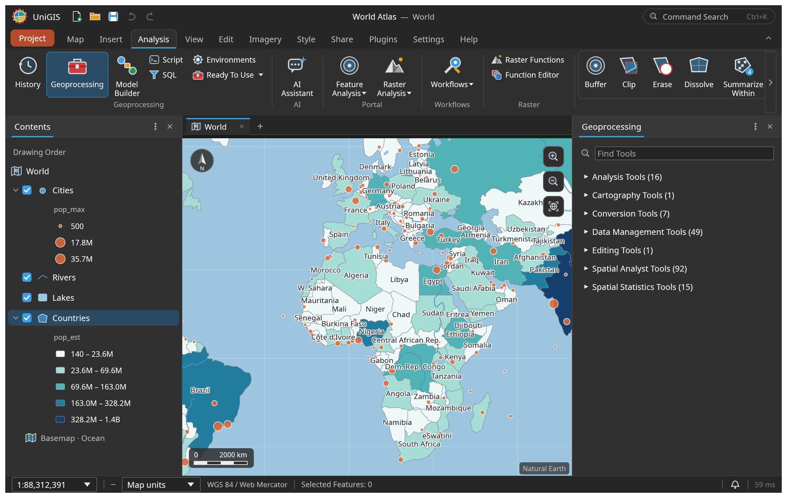
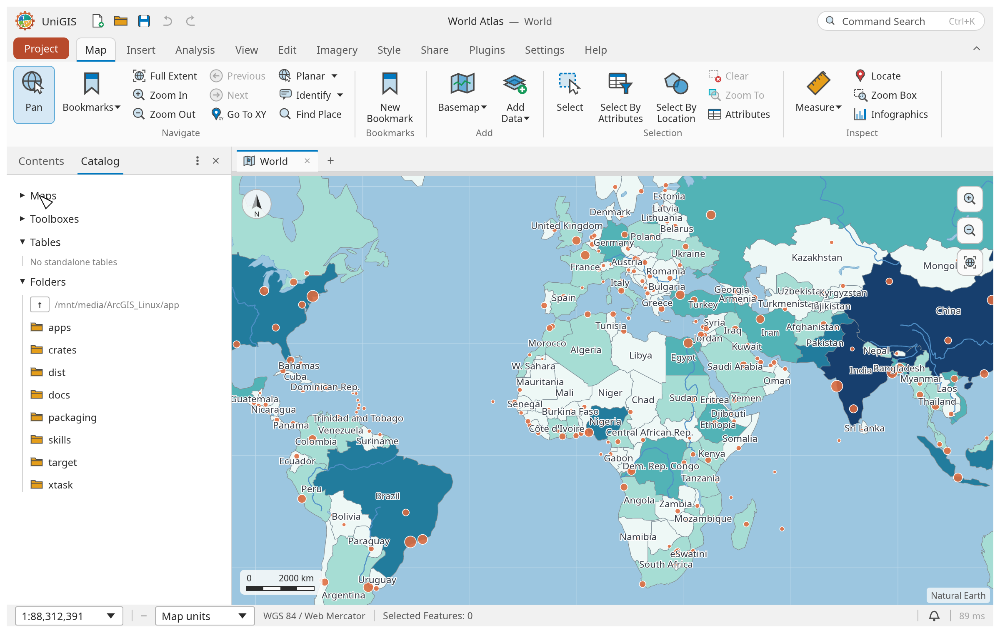

# UniGIS

A native-Linux GIS platform written in Rust, aiming for parity with ArcGIS Pro:
read/write File Geodatabases, Shapefiles and rasters, and run the standard
ArcToolbox-style analysis on them.

Status: **pre-alpha scaffold.** See [`docs/ROADMAP.md`](docs/ROADMAP.md) for the
phased plan and [`docs/SPEC.md`](docs/SPEC.md) for the full target scope.

## The app

UniGIS's desktop app (in [`app/`](app/), built on the Apache-2.0 RustGIS shell) has an ArcGIS-Pro-style
ribbon, dockable Contents and Catalog panes, and a single Geoprocessing tool tree organized by
ArcGIS toolbox. The Catalog pane opens file geodatabases and GeoPackages in place. Run it with `cargo run -p rustgis`
from `app/`.

| | |
|---|---|
|  |  |
| The map and Contents pane | Unified geoprocessing toolboxes |
|  |  |
| A tool form (Hot Spot Analysis) | Dark theme |



The screenshots are rendered offscreen by `app/crates/ui-egui/examples/ui_shot.rs`; the scripts that make
them are in [`docs/screenshots/scripts/`](docs/screenshots/scripts/).

## Layout

| Crate | Purpose |
|---|---|
| `unigis-core` | Geometry model, Esri field types, shared errors |
| `unigis-shapefile` | `.shp/.shx/.dbf/.prj/.cpg` read/write |
| `unigis-filegdb` | `.gdb` (FileGDB) read/write |
| `unigis-proj` | CRS + transformations |
| `unigis-raster` | Raster model, GeoTIFF, map algebra |
| `unigis-cli` | `ug` command-line tool |
| `unigis-testkit` | Test helpers: compare our readers with GDAL |

## Build

```sh
cargo build --workspace
cargo test --workspace
```

Requires Rust ≥ 1.85. Tests use GDAL's `ogrinfo` as an oracle when it is installed;
run `scripts/fetch-testdata.sh` for the larger third-party corpora.

```sh
ug describe data/roads.shp
ug copy-features data/roads.shp out/roads_copy.shp
```
